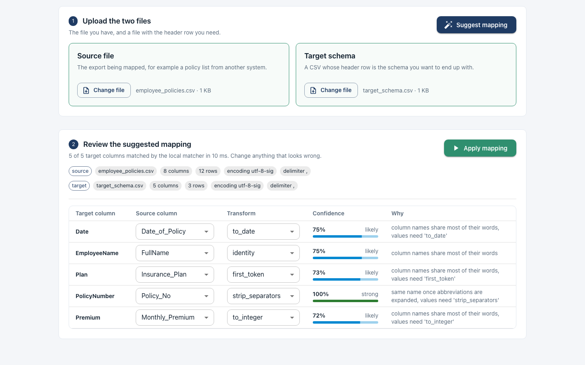

# CSV Column Mapper

Upload a source CSV and a target schema CSV, and the app suggests which source column should feed each target column, plus a conversion (for example `AB-12345` to `AB12345`, or `Gold Plan` to `Gold`). You can review and change every suggestion before applying the mapping and downloading the result.



Matching runs locally with string similarity and a synonym table, so no API key is needed. An OpenAI-based matcher can be switched on with an env var and falls back to the local one on any error.

## Features

- Handles BOMs, cp1252/latin-1 files, and comma, semicolon, tab or pipe delimiters
- Per-column confidence score and a short explanation for each suggestion
- 13 named transforms (`trim`, `strip_separators`, `to_integer`, `to_date`, and others); plans can only use these
- Apply a plan to preview rows or download the mapped CSV
- Every suggestion run is logged to SQLite

## Tech

- Backend: FastAPI, SQLAlchemy, SQLite, pytest
- Frontend: React (Create React App)

## Running it

```bash
cd backend
python3 -m venv .venv && source .venv/bin/activate
pip install -r requirements.txt
python scripts/init_db.py
uvicorn app.main:app --port 7241 --reload
```

```bash
cd front_end
npm install
npm start          # http://localhost:7242
```

Pick `sample_data/employee_policies.csv` as the source and `sample_data/target_schema.csv` as the target, then click Suggest mapping. API docs are at http://localhost:7241/docs.

Optional settings are listed in `backend/.env.example` and `front_end/.env.example`. The main ones:

- `SUGGESTER_BACKEND`: `local` (default) or `openai`
- `OPENAI_API_KEY`: only read when the backend is `openai`
- `MAX_UPLOAD_BYTES`, `MAX_ROWS`, `MIN_CONFIDENCE`
- `DATABASE_URL`: defaults to `sqlite:///./data/app.db`

A `docker-compose.yaml` is included for running both services in containers.

## Endpoints

```
GET  /api/health
GET  /api/transforms
POST /api/mappings/suggest
POST /api/mappings/apply          (?download=true for CSV)
GET  /api/runs
GET  /api/runs/{id}
```

## Tests

```bash
cd backend && pip install -r requirements-dev.txt && pytest
cd front_end && CI=true npm test
```

`backend/tests/fixtures/mapping_cases/` has six hand-written mapping cases used as a regression check for the matcher. Lint with `ruff check .` from `backend/`.

## Limitations

- One source column maps to at most one target column, so splitting a full name into two fields needs a hand-edited plan.
- Files are parsed in memory, capped at 5 MiB and 50,000 rows.
- The run log stores suggestions, not the mapping the user finally applied.
