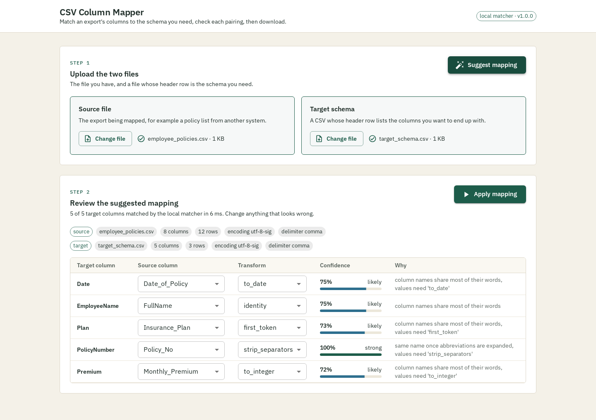
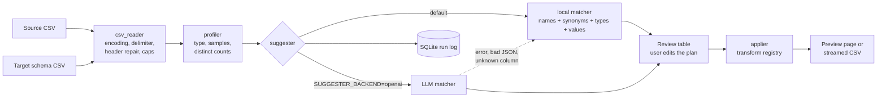
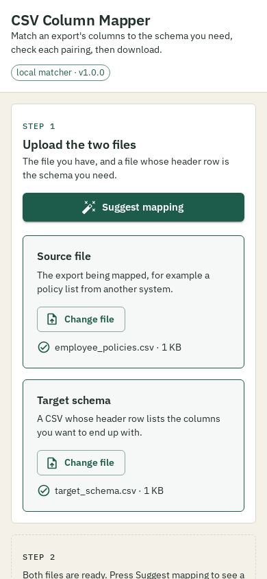
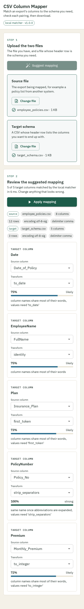
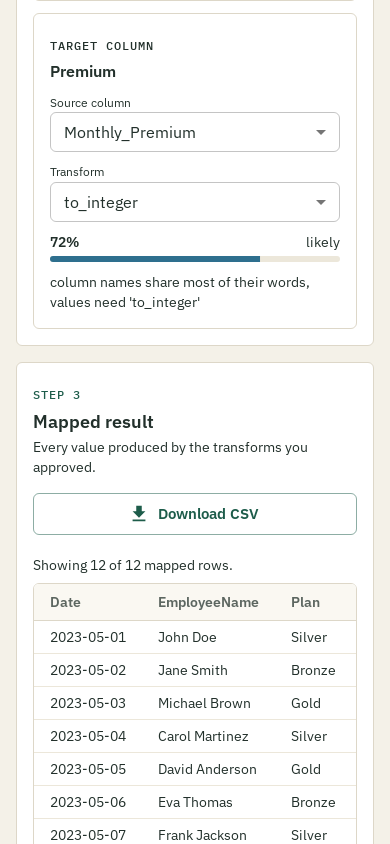
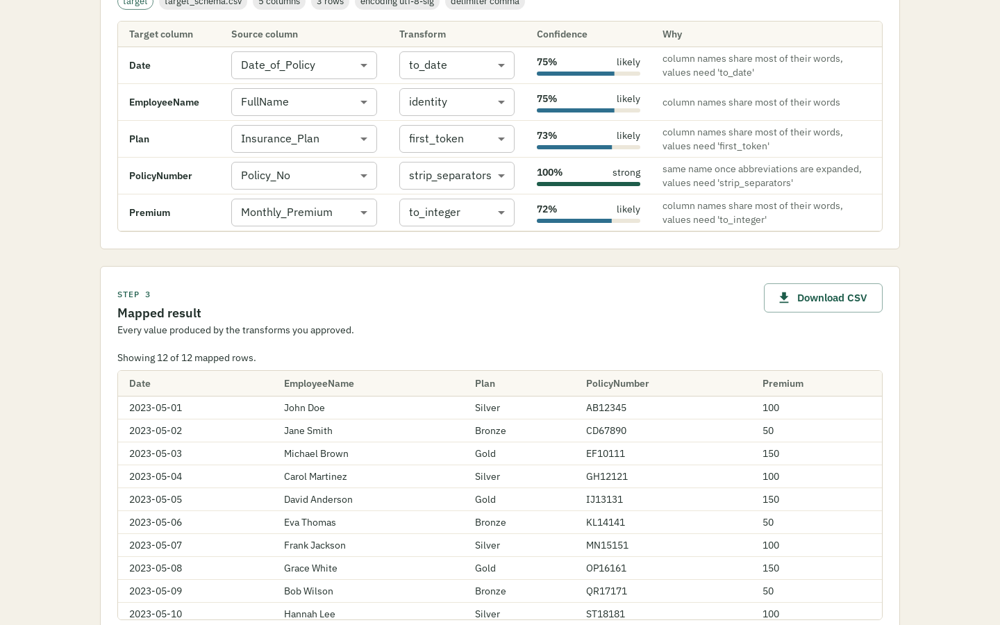

# CSV Column Mapper

Two systems rarely agree on column names. One export says `Policy_No`, `Date_of_Policy` and `Monthly_Premium`. The schema you have to load says `PolicyNumber`, `Date` and `Premium`, and it also wants `AB12345` instead of `AB-12345` and `100` instead of `100.0`.

This app takes the file you have and a CSV whose header row is the schema you need. It suggests a source column and a value conversion for every target column, and it shows a confidence score and a plain-English reason for each one. You review and change the plan, preview the result, and download the mapped CSV.



Matching is deterministic and runs locally, using string similarity and a synonym table, so the app works with no API key. An OpenAI-compatible matcher can be switched on with an environment variable. If anything goes wrong with it, it falls back to the local matcher.

## Quick start (Docker Compose)

```bash
docker compose up --build
```

- UI: http://localhost:7242
- API and interactive docs: http://localhost:7241/docs

In the UI, choose `sample_data/employee_policies.csv` as the source file and `sample_data/target_schema.csv` as the target schema, then press **Suggest mapping**. The run log is kept in a named volume (`api-data`). `docker compose down -v` removes it.

## How it works



**Reading the upload** (`app/services/csv_reader.py`). Uploads are read in 64 KiB chunks and refused once they pass 5 MiB, so an oversized file is never fully loaded. Bytes are decoded as UTF-8 (with or without a BOM), then cp1252, then latin-1. The delimiter is detected from comma, semicolon, tab and pipe. Blank and duplicate headers get unique names, ragged rows are padded, and a first row that is all numbers is treated as data. Each of these repairs adds a warning that the UI shows.

**Scoring a pairing** (`app/services/suggester/local.py`). Column names are split on camelCase, underscores and digits, and then folded through about 50 synonym groups. That way `Policy_No` and `PolicyNumber` both become `policy number`, and `zip_code` becomes `postcode` rather than an identifier. The score is a weighted sum of name similarity (0.5), token overlap (0.4) and type compatibility (0.1), plus a bonus when the two columns share values. Pairs are assigned greedily, one source per target. Anything below `MIN_CONFIDENCE` is reported as unmatched instead of being forced in. The runners-up stay available in the UI as alternatives.

**Proposing a conversion.** Date columns get `to_date` with the target's detected format. Decimal or currency into integer gets `to_integer`. Otherwise, each text transform is tried on the source sample and kept only when it lifts overlap with the target by at least 10 points. Overlap is measured on literal values first, then on value shapes (`AB-12345` becomes `A-9`), because a template file usually holds different example rows.

**Running a plan safely** (`app/services/transforms.py`). A plan can only name one of 13 registered transforms. Nothing in a request is evaluated, so the worst a bad plan (or a bad model answer) can do is produce wrong strings. The LLM's answer is checked against the real column names, and invented columns are dropped.

The six fixtures in `backend/tests/fixtures/mapping_cases/` (CRM, HR payroll, shipments, bank transactions, insurance and e-commerce) cover 45 target columns. The local matcher gets all 45 right, and `test_accuracy.py` fails if that drops.

## Using the UI

1. Choose the source file and the target schema. The parser's findings (encoding, delimiter, row count) appear as chips once the suggestion arrives.
2. Review each row. Picking a different source column swaps in that pairing's own score, reason and transform. A column the matcher never scored is marked "not scored".
3. Apply the mapping to preview the first 25 rows, then download the full CSV.

| Phone, step 1 | Phone, review | Phone, result |
| --- | --- | --- |
|  |  |  |



## API

| Method | Path | Purpose |
| --- | --- | --- |
| GET | `/api/health` | Liveness, active matcher, upload limits |
| GET | `/api/transforms` | The transforms a plan may use |
| POST | `/api/mappings/suggest` | Multipart `input_table` + `target_table` → suggestions |
| POST | `/api/mappings/apply` | Multipart `input_table` + JSON `plan` → preview page (`limit`, `offset`), or the whole CSV with `?download=true` |
| GET | `/api/runs`, `/api/runs/{id}` | Logged suggestion runs, newest first |

These examples were captured against the Compose stack:

```bash
curl -s localhost:7241/api/health
```

```json
{"status":"ok","version":"1.0.0","suggester":"local","llm_configured":false,"max_upload_bytes":5242880,"max_rows":50000}
```

```bash
curl -s -F input_table=@sample_data/employee_policies.csv \
        -F target_table=@sample_data/target_schema.csv \
        localhost:7241/api/mappings/suggest
```

One of the five suggestions in the response (the alternatives are trimmed here):

```json
{
  "target_column": "PolicyNumber",
  "best": {
    "source_column": "Policy_No",
    "confidence": 1.0,
    "rationale": "same name once abbreviations are expanded, values need 'strip_separators'",
    "transform": "strip_separators",
    "transform_options": {},
    "signals": {"name_similarity": 1.0, "token_overlap": 1.0, "type_match": 1.0, "value_overlap": 0.0}
  },
  "alternatives": [
    {"source_column": "Date_of_Policy", "confidence": 0.3883, "rationale": "weak match on name and type (38% similar)", "...": "..."}
  ]
}
```

The other four: `Date` ← `Date_of_Policy` (`to_date`, format `%Y-%m-%d`), `EmployeeName` ← `FullName`, `Plan` ← `Insurance_Plan` (`first_token`) and `Premium` ← `Monthly_Premium` (`to_integer`).

```bash
PLAN='{"mappings":[
  {"target_column":"Date","source_column":"Date_of_Policy","transform":"to_date","options":{"format":"%Y-%m-%d"}},
  {"target_column":"PolicyNumber","source_column":"Policy_No","transform":"strip_separators"},
  {"target_column":"Plan","source_column":"Insurance_Plan","transform":"first_token"},
  {"target_column":"Premium","source_column":"Monthly_Premium","transform":"to_integer"}]}'
curl -s -F input_table=@sample_data/employee_policies.csv -F "plan=$PLAN" \
        "localhost:7241/api/mappings/apply?limit=2"
```

```json
{"columns":["Date","PolicyNumber","Plan","Premium"],
 "rows":[{"Date":"2023-05-01","PolicyNumber":"AB12345","Plan":"Silver","Premium":"100"},
         {"Date":"2023-05-02","PolicyNumber":"CD67890","Plan":"Bronze","Premium":"50"}],
 "total_rows":12,"limit":2,"offset":0,"warnings":[]}
```

Errors come back as `{"error": <code>, "detail": <message>}`, with the offending file named:

```json
{"error":"invalid_file","detail":"'README.md' is not a CSV. Accepted extensions: .csv, .tsv, .txt."}
```

| Code | Status | Cause |
| --- | --- | --- |
| `file_too_large` | 413 | Over `MAX_UPLOAD_BYTES`, or more than 512 columns |
| `empty_file` | 422 | No header, or a header with no data rows |
| `invalid_file` | 400 | Wrong extension |
| `invalid_plan` | 422 | Bad JSON, unknown transform or column, duplicate target |
| `not_found` | 404 | Unknown run id |

## Running without Docker

You need Python 3.12 (see `backend/.python-version`) and Node 22.12 or later (see `front_end/.nvmrc`).

```bash
cd backend
python3 -m venv .venv && source .venv/bin/activate
pip install -r requirements.txt
python scripts/init_db.py            # add --demo to log one run over sample_data/
uvicorn app.main:app --port 7241 --reload
```

```bash
cd front_end
npm ci
npm run dev                          # http://localhost:7242
```

## Configuration

Every setting is optional. They are documented in `backend/.env.example` and `front_end/.env.example`.

| Variable | Default | Notes |
| --- | --- | --- |
| `SUGGESTER_BACKEND` | `local` | `openai` uses the LLM matcher when a key is set |
| `OPENAI_API_KEY` | unset | Read only by the API, never sent to the browser |
| `OPENAI_MODEL`, `OPENAI_BASE_URL` | `gpt-4o-mini`, OpenAI | Any OpenAI-compatible endpoint works |
| `MAX_UPLOAD_BYTES`, `MAX_ROWS` | 5 MiB, 50,000 | Files are parsed in memory |
| `MIN_CONFIDENCE` | `0.35` | Below this a target column is left unmatched |
| `DATABASE_URL` | `sqlite:///./data/app.db` | Any SQLAlchemy URL |
| `VITE_API_URL` | `http://localhost:7241` | Baked into the UI bundle at build time |

## Tests and lint

```bash
cd backend && pip install -r requirements-dev.txt && pytest && ruff check . && ruff format --check .
cd front_end && npm ci && npm test && npm run lint && npm run build
```

The backend has 136 pytest tests covering parsing edge cases, transforms, the matcher, the LLM fallback (against a stubbed transport), the API and the run log. The frontend has 8 Vitest and Testing Library tests for the review flow.

## Layout

```
backend/
  app/api/          routes and dependencies; routes only parse, delegate and serialise
  app/services/     csv_reader, profiler, transforms, applier, suggester/
  app/db/           SQLAlchemy model and repository for the run log
  scripts/init_db.py
front_end/src/      App, components/ (MappingTable, FilePicker, ...), api/client.js
sample_data/        the demo source file and target schema
```

## Limitations

- One source column feeds at most one target column, so splitting a full name into first and last needs a hand-edited plan.
- Uploads are parsed in memory, capped at 5 MiB and 50,000 rows.
- The run log stores the suggestions, not the plan the user finally applied.
- The LLM matcher returns no alternatives and no transform options, only its single choice per column.

## License

MIT, see [LICENSE](LICENSE).
